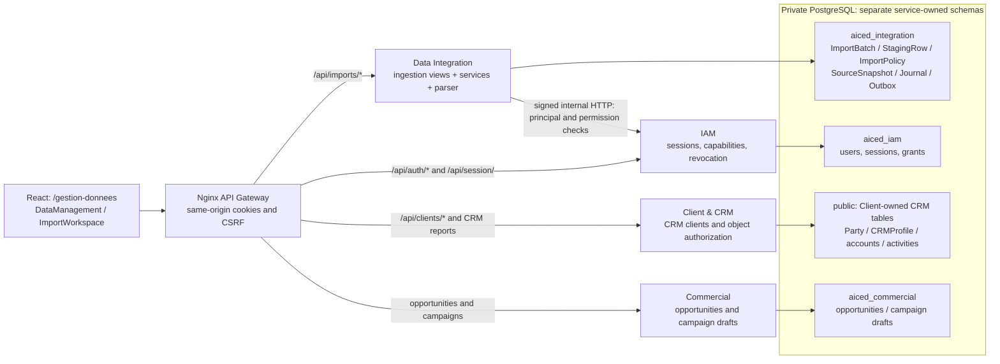

# Excel import and publication: functional and technical review

Reviewed against the running application and repository on 16 November 2026.
This is an investigation and correction plan, **not an implementation of fixes**.
No application code, API, migration, permission, Compose configuration or real
source mapping was changed during this review. Test fixtures were synthetic and
used only in the isolated test stack. Main-stack business operations were read-only.

## 1. Findings in plain English

An upload is deliberately saved as **Staging**, not automatically published.
There is no background job that eventually promotes it. A separate authorized
reviewer must explicitly publish it using a compatible, approved rule.

The current main stack explains the reported difficulty:

- Eight imports were staged when inspected. Five physical-person/account imports
  lacked a compatible approved rule. The main stack contained eight approved
  **legacy legal-entity** rules, but no approved physical-person or account rule.
  No classified synthetic/operational rule was approved there.
- The reviewer account **has** organization-level import-review permission.
  Changing accounts does not supply the missing rule.
- The latest physical-person import was declared `synthetic`, DMY, schema v1.
  Its server response was `policy_match.status = missing`, HTTP 200. Its
  publication control was correctly disabled. Its declaration is not proof
  that its contents are synthetic; no such contents were copied into testing.
- Three staged legal-entity imports had compatible legacy choices. The reviewer
  could open their publication dialog, but had to select a rule manually.
  I did **not** confirm publication in the main stack: the legacy rule labels
  mention synthetic/test use, which does not establish AMEN INVEST approval
  for operational records.
- Clicking **Examiner** successfully fetched and selected the correct import,
  but its preview heading appeared about **1,744 px below the top of a 900 px
  viewport**. The page did not scroll or move focus to the result. This
  reproduces the impression that the click did nothing.
- An account import using ISO had **99/99 rejected rows**. A different DMY
  account import had 0/99 rejected rows but still lacked a rule. A rule alone
  cannot make an entirely rejected batch publishable.

Publication is therefore not universally broken. A distinct reviewer successfully
published valid synthetic imports through the actual frontend during this review.
However, main-stack configuration, discoverability and several confusing messages
make that working path hard to find. The exact batch the user originally clicked
was not supplied; the findings above identify the current affected batch groups,
not an assumed historical click sequence.

## 2. Evidence and environment boundaries

| Environment | Entry point | Data and actions used in this investigation |
| --- | --- | --- |
| Main application | `http://127.0.0.1:5187` | Reviewer/operator login; authorized configuration and import metadata; reviewer opens three imports and cancels the available dialog. No upload, rule approval, revocation, publication or database mutation of business records. |
| Isolated test | `http://127.0.0.1:5188` | Generated synthetic XLSX files; separate importer/reviewer browser contexts; UI configuration, approval, publication and negative cases; SQL evidence; actual container restarts. |

Both use Docker Engine **29.9.3**, Compose **5.7.0**, four separate Django
services, React, Nginx and PostgreSQL. The projects do not share their database
volume or credentials. The main database may contain user-uploaded source data;
its disposable/synthetic initialization marker is **not** evidence that all
subsequent user uploads are synthetic.

The files inspected include `DataManagement.tsx`, `workspace-api.ts`, `api.ts`,
`LiveDashboard.tsx`, `CommercialActivity.tsx`, the gateway template/start script,
`ingestion/{parser,templates,services,views,matching,runtime}.py`,
`integration_store/models.py` and integrity migrations,
`integration_service/{access,journal,errors,source_mapping}.py`, IAM authorization
views, Client source-mapping/reporting code, Compose files and existing import
tests. Documentation comparisons included `import-templates.md`,
`import-source-mapping.md`, `publication-rule-reuse.md`,
`import-dashboard-validation.md` and the source-mapping approval matrix.

Local evidence is excluded from Git under `.local/data-import-review/`:

- `initial-metadata.json`: authorized main/test permissions and batch/rule metadata;
  no source cell values or Excel files from the main stack.
- `main-browser.json` and three cropped publication-state screenshots: actual
  reviewer behavior, viewport measurements, button states and request IDs.
- `main-validation-metadata.json`: validation error categories, not record values.
- `test-browser.json`: eight diagnostic scenarios, request/response status and
  error envelopes, request IDs, timings, publication IDs and cleanup evidence.
- `test-gateway-access.log`, `main-gateway-access.log`, service logs and
  `correlation-evidence.json`: 100/100 diagnostic request IDs matched gateway
  access records; 15/15 captured main import requests matched too.
- `cross-purpose-warning.json`, `header-comparison.json`: additional confirmed
  behavior and exact comparison of all 99 positional headers.

Passwords, session cookies, CSRF tokens, signing keys, real record values and
private source documents are not included in this report. Gateway access logs
live in `/opt/aiced/logs/access.log`; `docker compose logs gateway` alone does
not capture those access records. Existing service logs provide the signed IAM
round-trip IDs; they do not contain source cells.

## 3. Actual architecture and data flow



There is intentionally **no arrow from published source snapshots to CRM clients
or accounts**. Client's separate synthetic mapping preview calls Integration
with a signed request, but returns fixed synthetic examples, not the uploaded
snapshots. Integration explicitly refuses its internal mapping mode `published`.

The gateway configuration still calls the default upstream `legacy_backend`.
In the current Compose stack its value is **`client:8000`**, serving the Client
process, not a monolithic backend. Other upstreams are `integration:8002`,
`iam:8003` and `commercial:8004`. `AICED_REQUIRE_SERVICES=1` requires distinct
upstreams; there is no automatic fallback from imports to Client/monolith.
The variable name and an old template comment are misleading documentation debt.

### Permissions and trust

Every import read requires authenticated IAM authorization for **both**
`imports.view` and `clients.view_financial`, with full organization scope in
the same organization. Mutations additionally require:

| Operation | Extra capability / restriction |
| --- | --- |
| Upload | `imports.upload` |
| Propose rule | `imports.policy_manage` |
| Approve or revoke rule | `imports.approve`; creator cannot approve own rule |
| Publish batch | `imports.approve`; uploader cannot publish own batch |

The inspected demo reviewer has `approve=true`, `upload=false`,
`policy_manage=false`. It can approve somebody else's proposal and publish
somebody else's import; it cannot create the missing rule itself. The importer
has upload/configuration rights. These are existing capability assignments,
not an implicit meaning attached to the words reviewer, manager or IT.

Integration resolves the session through IAM and requests fresh signed
authorization. Mutations retain the existing writer fence, revocation barrier,
per-organization advisory lock and transaction. Neither a frontend flag nor a
caller-supplied UUID/role grants access. No cross-schema application query was
added for imports. Internal signatures, nonce/replay controls and IAM service
boundaries remain in force.

## 4. Complete upload-to-publication workflow

Let `R = /api/imports/{organization_id}/`.

| Step | Frontend and actual control | Request / service | Validation, persistence and failure behavior |
| --- | --- | --- | --- |
| Sign in | Existing login page | IAM auth/CSRF/session/access routes through Nginx | Existing cookie, CSRF, login and revocation controls. No import authority inferred from a role label. |
| Open Data Management | `DataManagement`; chooses an authorized organization | `GET /api/imports/context/` → Integration → signed IAM context | Returns catalog and org flags only. Missing required grants show denied/no organization. Unavailable context shows an error. |
| Select file | `ImportWorkspace` upload form | No upload request yet | User explicitly selects source model, source situation date, partial/complete nature, ISO/DMY and synthetic/operational usage. Default source model is legal entities; **the file type is not automatically detected**. File picker `.xlsx` is only a UI hint. |
| Validate and preview | **Valider et prévisualiser** | `POST Rupload/?template=…&source_as_of=…&snapshot_kind=…&date_format=…&data_scope=…`, binary body → Integration | Browser checks 10 MiB; gateway/body parser and OOXML parser enforce limits and structure. IAM upload grants checked. File-level failures return 400/413 with no staged batch; rejected file is audited when parser rejection is reached. |
| Parse and stage | Same synchronous HTTP request | `stage()` | SHA-256 and idempotency tuple checked. Rows parsed and source dates validated. Inside one transaction, fresh authorization/locks, quotas, batch and row inserts, journal/outbox. HTTP 201 means a new staged batch; HTTP 200 means an existing identical batch. There is no background worker. |
| Display result | `choose(result)`; preview section below history | `GET Rbatches/{id}/?page=1&rejected=0` → Integration | Returns row page, headers, metadata, history and rule suggestion. Only `staged` exists at this point. Preview errors have a retry panel; selecting a batch is in-page, not a new route/modal. |
| Browse history | **Imports & historique**, **Examiner →**, next/previous | `GET Rbatches/?page=N`; selected-batch GET | Fifty batches/rows per page by default. `Examiner` sets the selected UUID and fetches the correct preview. No automatic scroll/focus or batch deep link. |
| Inspect rejects | **Afficher uniquement les rejets** / **Rapport des rejets CSV** | Selected-batch GET with `rejected=1`; `GET Rbatches/{id}/rejections/` | Rejected rows remain immutable. CSV includes positions, source values and reasons, with spreadsheet-formula escaping and a download audit event. No inline editing of staged rows. |
| Resolve rule prerequisites | **Règles de publication** → **Proposer une règle** | `POST Rpolicies/` → Integration | Explicit catalog/key/date/schema/usage and rationale. Identical non-revoked proposal returns existing UUID; it does not create approval. Only authorized config users can propose. |
| Approve configuration | Pending proposals → **Approuver la règle** → **Confirmer la décision** | `POST Rpolicies/{id}/approve/` | Independent authorized approver required. A conflicting active classified rule blocks approval until explicit revocation. Approval itself does not publish a batch. |
| Open publication review | Selected batch → **Examiner la publication** | Opens `Dialog`, no publication request yet | Disabled for uploader, missing reviewer rights, incompatible/missing rule, invalid approved key, all-rejected rows or relevant loading/failure state. Legacy rules require manual selection. |
| Publish | Dialog **Revue avant publication** → **Confirmer la publication** | `POST Rbatches/{id}/publish/` with `policy_id`, `skip_rejected` → Integration | Server rechecks current rights, separate user, status, approved/non-revoked rule, org/type/schema/format/usage, rejected-row consent, nonempty accepted set and approved-key uniqueness. It never trusts only the suggestion. |
| Commit and confirm | **Publication enregistrée** and **Snapshot publié** | Same transactional `publish()` | Inserts immutable snapshots for accepted rows, sets publisher/time/rule/status, records journal/outbox atomically. Refreshes metadata/history. Failure rolls back all domain changes; staging remains. Lost HTTP acknowledgement can require a read-back; same-rule successful replay is idempotent. |

API errors use `error.status` and `error.details`. The frontend displays detailed
400/409/429 messages, but collapses 403 to a generic session/permission message
and most server failures to a generic service message. Request IDs are returned
in headers, not shown in the UI. Normal failed prerequisites can return HTTP 200
with a blocked match status: a successful preview does not mean permission to publish.

For the two small successful diagnostic publications, gateway request times were
0.144 s and 0.134 s, with three successful signed IAM round trips each. Missing
rejection consent, incompatible usage and an empty accepted set returned 400 in
0.123/0.137/0.146 s after successful IAM checks: those were business-validation
refusals, not dependency timeouts. The demo uploader's attempted publication
returned 403 in 0.086 s at IAM because that account lacks `imports.approve`.
A separate Docker scratch-database test with **both upload and approval
capabilities** additionally confirmed the explicit same-person approval/publication
checks, so those protections are not inferred solely from a missing capability.
These are small-fixture observations, not a load/maximum-size benchmark.

### Exact location of the working Publish controls

`Gestion des données` → `Imports & historique` → row **Examiner →** →
scroll below the history to **Prévisualisation du lot** → read
**État de publication** → **Examiner la publication** → dialog
**Revue avant publication** → choose the approved rule if legacy → explicitly
exclude rejected rows if applicable → **Confirmer la publication**.

The list has no button labelled simply “Publier”. The last confirmation is
hidden in the dialog. A disabled first control cannot open that dialog.
For actual main-stack files, do not select a test-labelled legacy rule merely
to make the control work: operational policy approval remains a prerequisite.

## 5. Persisted states and allowed transitions

```text
No batch -- valid file + authorized upload --> staged
staged  -- explicit authorized independent publication --> published
published -- replay with same rule --> same published batch (no duplicate snapshots)

Invalid file --> no batch + rejection audit where handled
Invalid rows inside a valid file --> staged batch with row errors
Failed publication --> still staged; no partially created snapshots
```

There is no persisted `validating`, `ready`, `submitted`, `reviewed`, `rejected`,
`cancelled`, `abandoned` or `failed` batch state. “In review/awaiting review” is
presentation around `staged`, not a task assignment. There is no submit-for-review
endpoint, reviewer inbox assignment, rejection decision/comment or notification.

A rule is pending, approved or revoked through its approval/revocation fields.
Its configuration has a UUID version; its `template_version` is the **Excel
schema version**, currently 1, not a human-friendly sequential approval number.

## 6. Main-stack symptom: confirmed causes and limits

### Rule inventory at inspection

| Source / scope / format | Approved compatible rules in main | Observed staged batches | Result |
| --- | --- | --- | --- |
| Physical / synthetic / DMY | 0 | 1 | Missing-rule response; reviewer publication disabled |
| Physical / legacy / DMY | 0 | 2 | Unclassified/manual path but no matching legacy choices; blocked |
| Accounts / legacy / DMY | 0 | 1 | 99 valid rows, but no approved rule; blocked |
| Accounts / legacy / ISO | 0 | 1 | 99 rejected rows and no rule; independently blocked for both reasons |
| Legal / legacy / DMY | 6 | 2 | Manual rule choices exist; reviewer can open dialog |
| Legal / legacy / ISO | 2 | 1 | Manual rule choices exist; publication still requires explicit review |

The default rule screen shows **zero approved reusable cards**, because
`view=approved` excludes `legacy`. Those eight legacy approvals are under
history and remain usable in the old manual batch path. “No approved rule” in
the default list can therefore be mistaken for “no approval exists anywhere”.

The staged physical batches each had seven birth-date validation errors.
They therefore still had 2,333 technically accepted rows each; the seven rejects
could be explicitly excluded **if** the correct publication policy were approved.
The messages identify column 9 and the chosen DMY interpretation, but do not
distinguish malformed, impossible or future date values. The account ISO batch's
first 50 rejected rows showed ISO date errors in positions 9, 12 and 16.
No real cell values were copied to testing or included here; the precise causes
of those individual invalid values are therefore not asserted.

### Browser reproduction

- Three main imports opened with HTTP 200, correct selected UUID and no JavaScript
  exception. Their preview heading was outside the initial viewport. The URL
  stayed `/gestion-donnees`; focus stayed on the clicked list action.
- Physical and account controls were disabled. The existing warning correctly
  said a compatible approval was missing, but the reason was also below the fold.
- The legacy legal dialog contained the placeholder plus six rule choices.
  **Confirmer la publication** existed and was disabled until a manual choice.
  I cancelled without publishing or approving anything in main.
- No spontaneous 5xx or permission denial caused these three main preview reads.
  IAM context confirmed the reviewer grants. This is not evidence that all
  possible network/authorization failures are absent.

The previous test success and this main-stack blockage are compatible: the
isolated tests explicitly supplied synthetic approved configurations. Those
approvals were not copied into main, and must not stand in for real approval.

## 7. Publication rules: purpose, reuse and remaining complications

A rule authorizes how an existing export becomes an immutable source snapshot:
which supported source/schema, which candidate key position, which explicit
date interpretation, which organization and declared usage, with an approval
rationale. It is **not** a CRM identity mapping or account-holder relationship.

- A user with `imports.policy_manage` proposes the configuration. An authorized
  user with `imports.approve`, different from its creator, approves it.
- One approved rule can already be reused for many compatible imports.
  A duplicate proposal with the same configuration and trimmed rationale returns
  the same non-revoked UUID; it creates a reuse audit event, not a new approval.
- A different key, schema, format, usage or documented policy rationale creates
  a new proposal. The service treats different rationale text conservatively;
  it does not determine whether two differently worded explanations mean the
  same policy. Cosmetic wording changes can still clutter pending proposals.
- At most one **classified** active approval exists per org/source/schema/date/
  usage. Explicit revocation is required before replacement approval. The
  uniqueness condition excludes legacy rows, which can still have duplicates.
- The creator cannot approve its own rule. Approving a rule never publishes
  even a valid batch. The uploader cannot publish its own batch even if the
  rule has already been independently approved.
- Revocation blocks future staged publications under that rule. It does not
  delete or modify already published snapshots, their approver or rule link.
  A replay of an already published batch with its original rule remains an
  idempotent read-back; it does not create a new publication.

### Matching actually implemented

For classified batches, Integration selects at most two active approved rules
matching org, template, schema version, date format and `data_scope`. It returns
`missing`, `ambiguous`, `schema`, `invalid_rows`, `invalid_key` or `matched`.
Only a unique valid match supplies the suggested policy. Approved-key checks use
SQL over valid staged rows; other row errors still require explicit exclusion.

For legacy batches it returns `unclassified`, no automatic suggestion and up to
100 compatible approved legacy choices for manual selection. This is deliberate
API compatibility, not evidence of operational approval. Optional public API
fields still default missing `data_scope` to `legacy`, so newly uploaded legacy
batches are technically possible through old API clients too.

Synthetic test rules appeared because regression/browser fixtures proposed and
approved them, previously with changing UUIDs/rationales, and the old UI listed
all versions together. New classified rule reuse and separate tabs reduce the
clutter, but historical legacy approvals were not automatically relabelled,
revoked or promoted. All eight main legacy rationales mention test/synthetic use.

### Isolation assessment

**Confirmed:** explicit synthetic and operational batches cannot publish with
each other's rules. The negative synthetic-fixture test returned 400 and left
zero snapshots. Neither scope label grants client/account mapping rights.

**Not fully isolated:** legacy is an unclassified compatibility path, not a
trusted third business environment. A test-looking legacy rule can still be
offered for an unclassified source. Also, the already-published-key warning in
`stage()` filters organization/template but not `data_scope` or schema version.
I reproduced an operational-declared synthetic fixture warning about an identifier
published only in synthetic scope. Publication still failed closed; the warning
crosses contexts. Do not describe isolation as complete at every UI/validation level.

Finally, choosing “synthetic” is a user declaration. The parser cannot prove
that arbitrary records are fictional. No label or matching heuristic should
automatically legalize operational data or establish business approval.

## 8. Three supported Excel structures and validation limits

The code and documented inventory agree on **all 99 headers and positions**:
33 physical-person, 25 legal-entity and 41 account columns. The complete exact
inventory is in Appendix A below and `backend/ingestion/templates.py`.

| Source | Required structure | Candidate snapshot key | Date columns with semantic parsing |
| --- | --- | --- | --- |
| Tiers personnes physiques | Exactly one sheet `Tier`, 33 headers; blank A; duplicate `Identifiant` B/AC | Text at B or AC for staging; approved rule selects B or AC for publication | F Creation Date; I Date de naissance |
| Tiers personnes morales | Exactly one sheet `Tier`, 25 headers; blank A | B Identifiant, text | E Creation Date |
| Comptes titres | Exactly one sheet `Compte titre`, 41 headers; blank A; E header has a trailing space | E `Numéro de compte `, text | I Date d'ouverture; L Creation Date; M Update Date; P Date de naissance |

Account D `Détenteur du compte` and AH `Identifiant` remain source cells. They
are not confirmed references to a person, Party UUID or CRM-owned account.
Multiple accounts per client are not inferred or materialized by this importer.

### File-level controls

- XLSX/OOXML ZIP signature and required package parts; no `.xls`/CSV importer.
- 10 MiB compressed, 25 MiB expanded, at most 1,000 entries, bounded compression
  ratio, no duplicate paths, encrypted entries, path traversal, macros, embedded
  objects, external links or unsafe XML entities.
- Exact single-sheet name and exact positional headers, including accents,
  spaces, duplicated labels and blank A. Columns beyond the supported schema
  are rejected. There is no flexible mapping/alias/header-trimming UI.
- At most worksheet row number 50,001 including the header. Empty data rows are
  skipped, but large worksheet coordinates can still exhaust that row-number cap.

Wrong model selection can yield **Colonnes hors schéma.**, rather than explaining
which supported model the file appears to match. This was observed when a
33-column physical fixture was submitted under the 25-column legal model.

### Record-level controls and what is *not* validated

- Cells preserve JSON primitives/null. Non-finite numbers, formulas, Excel error
  cells, unsupported values and strings over 2,000 characters produce errors.
- Candidate IDs must be text, at most 160 characters, with no surrounding
  whitespace; numeric IDs are not silently converted, preserving leading-zero
  semantics. Physical staging needs at least one candidate; publication needs
  the *approved* one. Neither name nor email is a required business identity.
- Every duplicate occurrence on **any candidate ID column** is rejected, even
  when that column is not the approved publication key. There is no first-row
  winner. Whether that is too strict for physical B/AC is a business-key decision.
- A key already published within org/source produces a warning, not a merge or
  overwrite. Its scope-filter defect is described above.
- Non-key fields, including phone, country, sector, LAB/FT, status, CEA and account
  category, are not validated against an approved semantic taxonomy. Numeric
  non-key cells can remain numeric. Preservation is not a confirmed domain mapping.
- Raw invalid cells and errors remain in staging. A corrected workbook is a new
  import; existing staged rows are not edited in place.

### Dates and counts

ISO uses Python ISO date/time parsing; DMY explicitly accepts `dd/mm/yyyy` and
`dd/mm/yyyy HH:MM:SS`. Native Excel date/datetime cells are accepted. Source cells
are retained separately from normalized ISO date strings. A date after the
declared source situation date is rejected; birth dates must not be future.
The implementation does not infer the business timezone of a naive source
timestamp. Django uses Africa/Tunis; the UI's source-date default/max uses the
browser date. Midnight differences and formal timestamp interpretation still
need a precise approved contract, not a silent conversion.

`total` is every retained nonempty staging row; `rejected` is rows with any error;
candidate accepted rows are `total - rejected`; `published_rows` counts actual
snapshots. With 3 staged rows / 2 rejected, explicit publication creates **1**
snapshot while retaining all 3 staged rows. All-rejected batches cannot publish.
The preview's paginated `count` changes when rejected-only is selected; batch
totals do not. Import pagination is fixed at 50 by the current paginator;
supplying `page_size=1` or `100` does not override it.

The batch-list serializer performs three row-count queries per batch rather
than annotated counts. At 50 batches this is 150 additional count queries plus
list/pagination/gate work. This is a confirmed query pattern, **not** a measured
cause of the current missing-rule or off-screen-preview problem.

## 9. Where the data goes and what survives

| Data | Actual location / behavior |
| --- | --- |
| Original XLSX | Read into the bounded parser and hashed; not archived by a FileField, upload store or downloadable-original API. Nginx may use temporary request buffering, which is not an application file archive. |
| Batch/provenance/status | `aiced_integration.ingestion_importbatch` |
| All staged cells, row numbers, raw errors/warnings and normalized dates | `aiced_integration.ingestion_stagingrow` |
| Rule versions/approvals/revocations | `aiced_integration.ingestion_importpolicy` |
| Published source records | `aiced_integration.ingestion_sourcesnapshot`: one-to-one reference to accepted immutable staging row plus source key and snapshot UUID/time. Values are not copied into CRM. |
| Audit and durable event delivery | `aiced_integration.integration_store_journal` and `integration_store_outbox`, created atomically with business mutations |
| CRM objects | Existing Client-owned `public.clients_party`, profiles, external identities and financial-account tables; this publication workflow does not populate them. |

Stored “raw cells” mean parsed cell values, not a lossless workbook archive:
native Excel date/datetime values are serialized as ISO strings, and workbook
formatting, binary date serials and original file bytes are not recoverable
from these rows alone.

Refresh/login/container restart does not erase PostgreSQL records. Main volume:
`aiced-s7_s7_database`; isolated test volume: `aiced-compose-test-database`.
Their actual Docker mountpoints are `/var/lib/docker/volumes/{volume}/_data`
inside Docker's Linux environment, not a database file in the repository.
Removing the volume, resetting the database or using `down -v` would be
destructive; none was used here. Persistence is not itself a backup strategy.
The open-preview selection is only React component state: a browser reload can
close that preview even though its batch and records remain in history.

You can inspect imported records through **Examiner** and the paginated preview,
before and after publication. You can select rejected-only and download reject
CSV. There is currently **no dedicated searchable published-record catalog**,
source-ID search, published-only row filter or original-file download.
The published preview still includes all staged rows, including excluded rejects;
it does not attach an explicit snapshot/publication flag to every displayed row.

### Panorama Clients, Client 360 and dashboards

Publication does not create `Party`, `ExternalIdentity` or `FinancialAccount`,
does not merge identities, and does not link account holders. A “complete” export
is a recorded declaration, not permission to delete records missing from it.

No current dashboard indicator consumes the uploaded source snapshots:

| Indicator | Current authorized source |
| --- | --- |
| Accessible clients / portfolio / profile completeness | Client CRM records, not person-export rows |
| Interactions / appointments / follow-ups | Existing CRM interaction, agenda and prospect records |
| Opportunity counts/statuses | Commercial API with Client-owned authorization |
| Campaign drafts | Existing private Commercial drafts |
| Encours, investment performance, retention | Unavailable where approved facts/definitions do not exist; no Excel-derived financial formula |

Consequently an import, even successfully published, can leave all these cards
unchanged. That is the present ownership contract, not evidence that rows were
forgotten. The home page already explains this distinction, but it does not
provide import-volume/publication-health cards.

Before real source data reaches Client 360, AMEN INVEST must approve person key
namespaces (especially B vs AC), account E / holder D / AH relationship semantics,
cardinalities/conflicts, authoritative fields and corrections, temporal/version
selection, and who can see which source record/field for an authorized CRM
object. Import organization scope must not be treated as Client object access.
The existing field-level approval matrix remains pending; no switch was enabled.

## 10. UX and functional defects confirmed or identified

| Finding | Evidence / consequence |
| --- | --- |
| Examiner result off-screen | Reproduced on three main imports; correct HTTP 200 and selected UUID, but preview outside viewport without focus/scroll feedback. |
| Publish control hard to discover | Two differently named controls, second inside modal; first below history and disabled when blocked. No direct batch URL or list-level reason/action. |
| Main rule coverage incomplete | No physical/account rule; reviewer cannot propose one. No contextual handoff to a config owner. Correct fail-closed behavior, incomplete operational setup. |
| Legacy approvals hidden by default | Default approved list is empty even though manual legal legacy choices exist. History combines genuinely revoked and still-approved unclassified rules. |
| Misleading missing-rule message | Reproduced with a genuinely approved physical rule whose key 29 was absent. Server says `invalid_key`; UI shows both that reason and **Aucune règle approuvée active** because it mistakes “no usable suggestion” for “no approval exists”. |
| Cross-purpose warning | Operational-declared synthetic fixture warned about key published only in synthetic scope. Final publication still returned 400. |
| Manual type/date/purpose selection | No automatic source detection; wrong-source failure can be an opaque schema error. Usage is declarative, not content verification. |
| Rule workflow too prominent/technical | UUIDs, column positions and rationale are necessary for config/review evidence but overwhelm ordinary upload tasks. Different rationale text can still create proposals; POST 201 does not prove a new version. |
| Review lifecycle incomplete | No formal submit/reject/abandon action or reviewer assignment. Stage is immediately visible to authorized org reviewers, not actively routed to someone. |
| Published rows difficult to distinguish | Table is still the staged-row table, including excluded rejects; no dedicated published-record search/filter. |
| Weak failure feedback | No visible correlation ID; 403 conflates session expiry and grants; duplicate block messages; lost acknowledgement does not explain “check actual publication status”. |
| Redundant availability dependency | Publication UI also depends on the separate rule-list query, even though preview contains server match/eligibility. Failure of a configuration-list request can disable otherwise matched review. |
| No safe terminal state for unusable staging | Entirely rejected/abandoned batches stay staged and consume staged quota. Default caps are 20 staged / 50 daily; both local stacks override to 1,000 / 2,000. Quotas were not the cause of the eight main staged imports. |
| Validation is technical, not a CRM identity contract | Optional names, arbitrary source classifications and duplicate handling across both physical candidates need approved meanings. “Validée fichier” must not imply verified client identity. |

Cached preview/matching data can remain in frontend state after a refetch error;
the current code derives `selected` and `match` from query data without an
explicit error guard. This is a code-inspection concern, not a separately
reproduced unauthorized publication: the backend still rechecks permission and
rule state. It should be tested during correction, with stale UI controls hidden
on authorization/dependency failure.

## 11. Prioritized correction plan — not implemented

### P0 — establish safe operational eligibility

**1. Approve the actual source configurations and classify existing history.**
Category: **Business-policy dependency**. The primary current blocker is missing
approved configuration, not a missing publication endpoint. AMEN INVEST must
confirm keys, formats, purpose and publication policy per actual source. Then
authorized config owners propose and distinct reviewers approve those versions
through existing APIs. Never copy test approval into production or relabel old
records just to unlock publication. Files/services: approval matrix, operational
runbook, existing Integration rule UI/API; a historical transition may need a
separate additive model/approval record. Risk: inappropriate approval could
authorize sensitive source publication; require documented ownership/visibility
and an explicit transition with immutable old import links.

**2. Close the unclassified/test-rule transition gap deliberately.**
Category: **Critical bug fix**, with a business/compatibility dependency. New
classified paths enforce purpose, but optional legacy creation and manually
usable test-looking legacy approvals cannot establish operational segregation.
Plan a deny-by-default transition for new unclassified writes while retaining
historical reads/replays and provenance. Files: `ingestion/services.py`,
`views.py`, `matching.py`, rule migrations only if justified, contract tests and
transition documentation. Risk: breaking old API clients or stranding legitimate
history; agree the deprecation/approval path first. Do not bulk revoke/reclassify
or weaken separate review as an unreviewed quick fix.

### P1 — smallest verified usability and correctness corrections

**3. Make Examiner visibly open the selected import.**
Category: **User experience improvement**. Focus/scroll to the preview or its
error heading after selection; identify the selected row and show loading.
An optional batch deep link can follow if useful. Files:
`DataManagement.tsx`, import browser tests; no backend/schema change needed for
the minimal correction. Risk: focus jumps on background refresh or pagination;
trigger on deliberate selection and respect keyboard access. Acceptance:
desktop/mobile selection reveals the correct import without manual hunting,
including a list longer than one viewport and failed preview fetch.

**4. Show one truthful eligibility reason, including failed checks.**
Category: **Critical bug fix**. Distinguish `missing`, `invalid_key`,
`invalid_rows`, unavailable preview and legacy manual selection. A missing usable
suggestion is not proof that no approved policy exists. Files:
`DataManagement.tsx`, `workspace-api.ts`, possibly additive preview metadata in
`matching.py/views.py`; retain server authority. Risk: accidentally enabling an
invalid publication while changing UI logic. Acceptance: valid approved-key
failure remains blocked but names the actual correction; no duplicate/misleading
message; loading/error states never offer stale authorization as current.

**5. Scope prior-publication warnings to the correct source context.**
Category: **Critical bug fix**. The warning query must not mix synthetic,
operational and legacy or incompatible schema/key namespaces. Files:
`ingestion/services.py`, backend/browser isolation tests. Keep bounded lookup
batches and do not merge identities. Risk: suppressing a meaningful same-context
warning or assuming B/AC are equivalent namespaces. Acceptance: same-scope known
key warns; cross-purpose fixture does not; publication permissions remain unchanged.
Existing stored warnings are immutable evidence; qualify their historical context
in the view if needed, rather than rewriting old staged/snapshot records.

**6. Provide a reviewer-oriented queue and contextual next action.**
Category: **Functional improvement**. Show ready/blocked staged imports, the
exact blocker, selected source/format/usage, human-readable uploader context,
and “open review” or “configuration approval needed”. Reuse current org scopes.
Files: `DataManagement.tsx`, `workspace-api.ts`, compatible optional filters in
`BatchListView`, tests. Risk: leaking metadata/counts if filtering precedes
authorization, or inventing team assignments. Acceptance: importer/reviewer see
only their existing authorized org data; no new assignment or notification policy.

**7. Clarify reusable rules versus history.**
Category: **User experience improvement**. Separate still-approved unclassified
legacy records from revoked versions; show why neither is an approved
operational configuration. Keep advanced version UUIDs/provenance in expandable
details. Offer rule reuse before new proposals; separate upload-form state from
rule-form state. Files: rule UI, existing policy-list filters and tests.
Risk: concealing necessary audit evidence or implying legacy approval is current
business consent. Acceptance: one normal reusable configuration card per approved
compatibility group; all versions remain accessible to authorized users.

### P2 — improve inspection and maintenance after the blockers

**8. Add a bounded source-snapshot inspection view, not CRM integration.**
Category: **Functional improvement**. Search/filter published records by source
key/type/source date/status, show provenance and explicit included/excluded flags.
Files: Integration read APIs/serializers, frontend import inspection, reviewed
OpenAPI additions and isolation tests. Risk: exposing personal/financial source
records under inappropriate CRM permissions. Retain current full import/financial
org scope unless AMEN INVEST approves finer rules; authorize before counts/pages.

**9. Suggest source type using validated structure.**
Category: **User experience improvement**. Detect only an unambiguous catalog
sheet/header match; never infer from filename or choose an identity key. Keep
explicit date interpretation where ambiguous. Files: parser/intake contract,
`DataManagement.tsx`, compatible API additions and workbook tests. Risk: silently
accepting changed schemas; unknown/ambiguous structures must fail closed and
require approved catalog versioning.

**10. Measure and reduce redundant count/eligibility requests.**
Category: **Functional improvement**. Benchmark real batch-list size and preview
cost, then annotate bounded counts and use the authorized preview's canonical
eligibility instead of the unrelated config-list availability. Files:
`ingestion/views.py`, `matching.py`, frontend queries and correctness/performance
tests. Risk: count inflation from joins, stale approval decisions or altered
pagination. Preserve deterministic pages, current server rechecks and existing
resource limits; do not solve this by globally increasing timeouts.

**11. Define reject/abandon/retention semantics before adding lifecycle actions.**
Category: **Business-policy dependency**. An unusable staged batch currently has
no terminal state and continues consuming staged quota. Approve who can abandon,
reject, resubmit and retain a source import, then add an auditable non-destructive
action if required. Files: models/migrations, services, UI, quotas, runbook/tests.
Risk: erasing evidence or releasing quota through an unauthorized action. Preserve
rows/history; no database-delete workaround or guessed cancellation policy.

**12. Confirm physical-key and duplicate/date semantics.**
Category: **Business-policy dependency**. Decide B vs AC, alternate-ID uniqueness,
whether invalid unused candidates should reject an otherwise publishable row,
and source timestamp/as-of meaning. Files: approval matrix, template policy,
parser/services and focused tests after approval. Risk: weakening identity safety
or accepting malformed source records. No validation relaxation in this review.

**13. Improve success, error and uncertain-outcome feedback.**
Category: **User experience improvement**. Show saved-staging confirmation,
review handoff, publication ID/time/reviewer and actual snapshot view. Display a
safe correlation ID and contextual error actions. On timeout, reconcile with a
read before claiming failure or success. Files: `DataManagement.tsx`, `api.ts`,
UI components and browser tests. Risk: exposing internals or retrying writes
blindly; show safe messages and keep idempotence/server permissions unchanged.

### P3 — downstream integration remains approval-gated

**14. Authorize real Client 360 source relationships separately.**
Category: **Business-policy dependency**. Approve MAP/OWN/VIS/LIFE, source fields,
relationship evidence, conflict handling and object/field visibility before
implementing actual read-only projections. Files: existing approval matrix and
future bounded signed Client↔Integration contracts/tests. Risk: false client
identity/account links or unauthorized personal/financial disclosure. No direct
cross-schema reads, automatic merges, new services or invented financial KPIs.

Recommended first code increment after review: items **3–5**, with targeted
browser/authorization regression. Operational activation still depends on items
**1–2** and must not be bundled into a UX fix.

## 12. Proposed simpler user workflow

1. A configuration owner prepares the supported source contract once; a separate
   authorized approver approves its reusable version. Ordinary uploaders do not
   recreate it for every workbook.
2. The uploader selects a file. A bounded structural check suggests its supported
   type and matching approved configuration. Any ambiguous date interpretation
   is explicit. No configuration is automatically approved.
3. A visible summary shows saved staging, source date/usage, total/valid/rejected
   rows and concrete corrections. A failed requirement stays blocked with a
   contextual request for configuration review, not an unexplained disabled button.
4. The batch is clearly available for independent review. The minimal workflow
   can use the existing staged state and a reviewer queue; a formally distinct
   “submitted” state needs an approved lifecycle decision rather than an invented
   extra approval step.
5. A different authorized reviewer opens a direct, visible batch view with
   provenance, validation, approved configuration and any explicit exclusions.
6. One clearly labelled **Publier le snapshot** action opens the necessary final
   confirmation. Server authorization, revocation, row eligibility and policy
   state are rechecked transactionally.
7. The interface confirms the immutable publication and opens its source snapshot.
   It explicitly states that CRM clients/accounts and dashboards were not updated
   by a source publication. Advanced configuration/history remains accessible.

This simplifies navigation and preparation; it does not remove independent
review, approve a business identifier, create Client relationships or turn source
counts into financial performance.

## 13. Verification executed for this review

| Verification | Result / scope |
| --- | --- |
| Main-stack Chromium inspection | 3 real staged imports opened; missing-rule blocks and available legal dialog confirmed; 15 import GET request IDs correlated; 0 JavaScript exceptions; no business mutation |
| New isolated Chromium diagnostic | **8 scenarios passed**: missing rule; UI rule proposal + independent approval; valid UI publication + reload; invalid approved key + misleading message; rejected-row consent; purpose mismatch; all-rejected dates; wrong model |
| Separate accounts | Importer and reviewer in separate browser contexts. Self-approval and self-publication returned 403; both UI review/publication stages exercised. |
| Dual-capability separation check | **1 additional backend test passed** in a separate Docker-created scratch database: an actor with upload/configuration/approval rights still cannot approve its own rule or publish its own batch; a different authorized actor can. |
| Existing relevant Playwright suites | **6 passed**, 0 failed: `import-dashboard.spec.ts` and `workspace.spec.ts`; all three synthetic source types published through frontend, duplicate replay, CSV and exclusion flows covered |
| Diagnostic SQL/audit checks | **4 groups passed** before and after restart: correct accepted/excluded snapshots, uploader ≠ publisher, one publication journal/outbox pair, blocked imports still staged with zero snapshots |
| Actual Docker restart persistence | Integration and PostgreSQL restarted in isolated stack; original three-source fixture SQL fingerprints and two diagnostic-publication fingerprints unchanged |
| Header inventory | All 99 positions exactly agree with documented workbook structures |
| Existing backend regression suites | **242 passed**: 206 general, 5 IAM, 13 Integration, 18 Commercial; 0 failures |
| Security, authorization and OpenAPI through gateway | **15 checks passed**, including restricted database credentials, independent histories, IAM revocation, signed communication and audit delivery |
| Public routes | **52 routes / 65 method-paths passed** compatibility/authentication probes |
| Final Docker health | **7 healthy containers in each stack**, four independent Django processes, internal DNS and private PostgreSQL |
| No application/main-import changes | All 7 recorded code/configuration hashes unchanged; all initial main batch/rule metadata unchanged after the investigation |

The diagnostic initially used an overly exact label locator, then an incorrect
assumption that the wrong-model error would contain “modèle”. The UI actually
returned **Colonnes hors schéma.**. Those diagnostic expectations were corrected;
the application was not changed or retried to conceal a 5xx. The earlier partial
diagnostic evidence is retained as `test-browser-attempt1.json`.

All 100 captured isolated diagnostic import requests were expected outcomes:
88 HTTP 200, 6 HTTP 201, 2 HTTP 403 and 4 HTTP 400. None was an unexpected
5xx; no JavaScript exception was captured. Only synthetic test configuration
was approved during diagnostics, through the UI with separate accounts. Its
subsequent authorized revocation retained its published snapshots and rule links;
no historical record was deleted or reclassified.

Commands used for the existing suites (all services are Docker processes):

```powershell
python scripts/compose_browser.py --test import-dashboard.spec.ts workspace.spec.ts
python scripts/compose_import_dashboard_restart.py --test
docker compose -f compose.yaml -f compose.test.yaml run --rm --no-deps initialize python /s7/regression.py
docker compose -f compose.yaml -f compose.test.yaml run --rm --no-deps initialize python /s7/verify.py
docker compose -f compose.yaml -f compose.test.yaml run --rm --no-deps initialize python /s7/routes.py
python scripts/compose_inventory.py --test
```

The additional read-only/main and synthetic diagnostic scripts and screenshots
are under `.local/data-import-review/`; their credentials are read from excluded
configuration and never embedded in the report. Database fingerprint evidence
also exists under `.local/compose-test/import-review-sql.json` and
`import-dashboard-restart.json`. No local development server, real customer
workbook, direct publication-status update or database reset was used.

The complete 45-case browser suite was **not rerun** for this investigation;
the six relevant existing cases and eight explicit diagnostic scenarios are
the fresh browser evidence. Prior full-suite acceptance is historical evidence,
not a substitute for the current reproductions. S16.1's intermittent pipeline
503 remains an **open, separate release risk**; no causal pipeline fix or
production readiness is claimed here.

## 14. AMEN INVEST decisions and unchanged restrictions

- Approved operational source namespaces, person B/AC choice, account E key and
  date interpretation; formal ownership/meaning of every source attribute.
- How existing test-labelled/unclassified rules and imports transition, and
  compatibility/deprecation of new legacy API writes. Do not infer approval from
  an old test rationale or a declared usage label.
- Who may upload, manage configuration, approve rules, review publications and
  inspect source records/fields; whether current full-org financial/import scope
  is appropriate. No inferred manager-wide or IT financial access.
- Any formal submit/reject/abandon/assignment policy; retention, immutable raw-file
  archiving if desired, erasure obligations, encrypted backup and recovery policy.
- Date/timestamp timezone/as-of semantics, duplicate handling and approved
  source-to-CRM relationships and correction/conflict workflows.
- Financial facts/definitions required for future financial KPIs. The current
  exports do not supply usable valuations, quantities, currencies or performance.

Carthago remains read-only. Published snapshots, staging, rule version identity
and audit history remain protected. Client owns business-object authorization;
Integration owns source records; IAM owns sessions/grants/revocation. No source
identity merge, account creation, real Client 360 projection, finance KPI,
additional service, queue or ownership restructuring was activated.

**Review outcome:** the mechanics can publish safely with approved synthetic
fixtures, but operational configuration and UX are incomplete. Approve a scoped
correction plan before implementing changes. Do not certify the operational
source workflow merely because the test stack can publish its own fixtures.

## Appendix A. Exact supported header inventory

The tables below are generated from the current catalog, compared against the
documented inventory. “Primitive” means source string/number/boolean/null subject
to global safety limits, **not** an approved business type or CRM mapping.
Key and date requirements are the technical rules described in section 8.

### physical: sheet `Tier`, schema v1

| Position | Exact header | Implemented technical validation |
| --- | --- | --- |
| 1 | (blank / null) | Optional source primitive/null; safety limits only; no approved CRM mapping |
| 2 | `Identifiant` | Candidate text key, max 160; approved key must be present at publication |
| 3 | `Nom` | Optional source primitive/null; safety limits only; no approved CRM mapping |
| 4 | `Prénom` | Optional source primitive/null; safety limits only; no approved CRM mapping |
| 5 | `Nom Complet` | Optional source primitive/null; safety limits only; no approved CRM mapping |
| 6 | `Creation Date` | Optional if empty; otherwise native Excel date or explicitly selected ISO/DMY; normalized separately |
| 7 | `Type de pièce d'identité` | Optional source primitive/null; safety limits only; no approved CRM mapping |
| 8 | `N° de pièce d'identité` | Optional source primitive/null; safety limits only; no approved CRM mapping |
| 9 | `Date de naissance` | Optional if empty; otherwise native Excel date or explicitly selected ISO/DMY; normalized separately |
| 10 | `Commentaire` | Optional source primitive/null; safety limits only; no approved CRM mapping |
| 11 | `Chargé client` | Optional source primitive/null; safety limits only; no approved CRM mapping |
| 12 | `Téléphone` | Optional source primitive/null; safety limits only; no approved CRM mapping |
| 13 | `Mobile` | Optional source primitive/null; safety limits only; no approved CRM mapping |
| 14 | `Fax` | Optional source primitive/null; safety limits only; no approved CRM mapping |
| 15 | `Email` | Optional source primitive/null; safety limits only; no approved CRM mapping |
| 16 | `Fonction Contact` | Optional source primitive/null; safety limits only; no approved CRM mapping |
| 17 | `Secteur d'activité` | Optional source primitive/null; safety limits only; no approved CRM mapping |
| 18 | `Adresse` | Optional source primitive/null; safety limits only; no approved CRM mapping |
| 19 | `Ville` | Optional source primitive/null; safety limits only; no approved CRM mapping |
| 20 | `Code postal` | Optional source primitive/null; safety limits only; no approved CRM mapping |
| 21 | `Risque LAB/FT` | Optional source primitive/null; safety limits only; no approved CRM mapping |
| 22 | `Sexe` | Optional source primitive/null; safety limits only; no approved CRM mapping |
| 23 | `Civilité` | Optional source primitive/null; safety limits only; no approved CRM mapping |
| 24 | `Etat Civil` | Optional source primitive/null; safety limits only; no approved CRM mapping |
| 25 | `Père` | Optional source primitive/null; safety limits only; no approved CRM mapping |
| 26 | `mère` | Optional source primitive/null; safety limits only; no approved CRM mapping |
| 27 | `Code SWIFT` | Optional source primitive/null; safety limits only; no approved CRM mapping |
| 28 | `Biccode` | Optional source primitive/null; safety limits only; no approved CRM mapping |
| 29 | `Identifiant` | Candidate text key, max 160; approved key must be present at publication |
| 30 | `Pays de nationalité` | Optional source primitive/null; safety limits only; no approved CRM mapping |
| 31 | `Résident` | Optional source primitive/null; safety limits only; no approved CRM mapping |
| 32 | `Pays de résidence` | Optional source primitive/null; safety limits only; no approved CRM mapping |
| 33 | `Pays de naissance` | Optional source primitive/null; safety limits only; no approved CRM mapping |

### legal: sheet `Tier`, schema v1

| Position | Exact header | Implemented technical validation |
| --- | --- | --- |
| 1 | (blank / null) | Optional source primitive/null; safety limits only; no approved CRM mapping |
| 2 | `Identifiant` | Required text source key, max 160; no numeric conversion |
| 3 | `Libellé Court` | Optional source primitive/null; safety limits only; no approved CRM mapping |
| 4 | `Libellé Long / Raison Sociale` | Optional source primitive/null; safety limits only; no approved CRM mapping |
| 5 | `Creation Date` | Optional if empty; otherwise native Excel date or explicitly selected ISO/DMY; normalized separately |
| 6 | `Chargé client` | Optional source primitive/null; safety limits only; no approved CRM mapping |
| 7 | `Téléphone` | Optional source primitive/null; safety limits only; no approved CRM mapping |
| 8 | `Mobile` | Optional source primitive/null; safety limits only; no approved CRM mapping |
| 9 | `Fax` | Optional source primitive/null; safety limits only; no approved CRM mapping |
| 10 | `Fonction Contact` | Optional source primitive/null; safety limits only; no approved CRM mapping |
| 11 | `Secteur d'activité` | Optional source primitive/null; safety limits only; no approved CRM mapping |
| 12 | `Adresse` | Optional source primitive/null; safety limits only; no approved CRM mapping |
| 13 | `Ville` | Optional source primitive/null; safety limits only; no approved CRM mapping |
| 14 | `Code postal` | Optional source primitive/null; safety limits only; no approved CRM mapping |
| 15 | `Sexe` | Optional source primitive/null; safety limits only; no approved CRM mapping |
| 16 | `Civilité` | Optional source primitive/null; safety limits only; no approved CRM mapping |
| 17 | `Etat Civil` | Optional source primitive/null; safety limits only; no approved CRM mapping |
| 18 | `Code SWIFT` | Optional source primitive/null; safety limits only; no approved CRM mapping |
| 19 | `Risque LAB/FT` | Optional source primitive/null; safety limits only; no approved CRM mapping |
| 20 | `Biccode` | Optional source primitive/null; safety limits only; no approved CRM mapping |
| 21 | `Pays de nationalité` | Optional source primitive/null; safety limits only; no approved CRM mapping |
| 22 | `Résident` | Optional source primitive/null; safety limits only; no approved CRM mapping |
| 23 | `Pays de résidence` | Optional source primitive/null; safety limits only; no approved CRM mapping |
| 24 | `Pays de naissance` | Optional source primitive/null; safety limits only; no approved CRM mapping |
| 25 | `Commentaire` | Optional source primitive/null; safety limits only; no approved CRM mapping |

### accounts: sheet `Compte titre`, schema v1

| Position | Exact header | Implemented technical validation |
| --- | --- | --- |
| 1 | (blank / null) | Optional source primitive/null; safety limits only; no approved CRM mapping |
| 2 | `Agence UIB` | Optional source primitive/null; safety limits only; no approved CRM mapping |
| 3 | `Fréquence du reporting` | Optional source primitive/null; safety limits only; no approved CRM mapping |
| 4 | `Détenteur du compte` | Optional source primitive/null; safety limits only; no approved CRM mapping |
| 5 | `Numéro de compte ` | Required text source key, max 160; no numeric conversion |
| 6 | `Prénom` | Optional source primitive/null; safety limits only; no approved CRM mapping |
| 7 | `Nom` | Optional source primitive/null; safety limits only; no approved CRM mapping |
| 8 | `Nom Complet` | Optional source primitive/null; safety limits only; no approved CRM mapping |
| 9 | `Date d'ouverture` | Optional if empty; otherwise native Excel date or explicitly selected ISO/DMY; normalized separately |
| 10 | `CEA` | Optional source primitive/null; safety limits only; no approved CRM mapping |
| 11 | `Pack de frais` | Optional source primitive/null; safety limits only; no approved CRM mapping |
| 12 | `Creation Date` | Optional if empty; otherwise native Excel date or explicitly selected ISO/DMY; normalized separately |
| 13 | `Update Date` | Optional if empty; otherwise native Excel date or explicitly selected ISO/DMY; normalized separately |
| 14 | `Update User` | Optional source primitive/null; safety limits only; no approved CRM mapping |
| 15 | `Type de pièce d'identité` | Optional source primitive/null; safety limits only; no approved CRM mapping |
| 16 | `Date de naissance` | Optional if empty; otherwise native Excel date or explicitly selected ISO/DMY; normalized separately |
| 17 | `Chargé client` | Optional source primitive/null; safety limits only; no approved CRM mapping |
| 18 | `Status` | Optional source primitive/null; safety limits only; no approved CRM mapping |
| 19 | `Téléphone` | Optional source primitive/null; safety limits only; no approved CRM mapping |
| 20 | `Mobile` | Optional source primitive/null; safety limits only; no approved CRM mapping |
| 21 | `Fax` | Optional source primitive/null; safety limits only; no approved CRM mapping |
| 22 | `Email` | Optional source primitive/null; safety limits only; no approved CRM mapping |
| 23 | `Fonction Contact` | Optional source primitive/null; safety limits only; no approved CRM mapping |
| 24 | `Secteur d'activité` | Optional source primitive/null; safety limits only; no approved CRM mapping |
| 25 | `Adresse` | Optional source primitive/null; safety limits only; no approved CRM mapping |
| 26 | `Ville` | Optional source primitive/null; safety limits only; no approved CRM mapping |
| 27 | `Code postal` | Optional source primitive/null; safety limits only; no approved CRM mapping |
| 28 | `Risque LAB/FT` | Optional source primitive/null; safety limits only; no approved CRM mapping |
| 29 | `Sexe` | Optional source primitive/null; safety limits only; no approved CRM mapping |
| 30 | `Civilité` | Optional source primitive/null; safety limits only; no approved CRM mapping |
| 31 | `Etat Civil` | Optional source primitive/null; safety limits only; no approved CRM mapping |
| 32 | `Swiftcode` | Optional source primitive/null; safety limits only; no approved CRM mapping |
| 33 | `Biccode` | Optional source primitive/null; safety limits only; no approved CRM mapping |
| 34 | `Identifiant` | Optional source primitive/null; safety limits only; no approved CRM mapping |
| 35 | `Type de gestion` | Optional source primitive/null; safety limits only; no approved CRM mapping |
| 36 | `Catégorie d'avoirs` | Optional source primitive/null; safety limits only; no approved CRM mapping |
| 37 | `Pays de nationalité` | Optional source primitive/null; safety limits only; no approved CRM mapping |
| 38 | `Resident` | Optional source primitive/null; safety limits only; no approved CRM mapping |
| 39 | `Pays de résidence` | Optional source primitive/null; safety limits only; no approved CRM mapping |
| 40 | `Foreign` | Optional source primitive/null; safety limits only; no approved CRM mapping |
| 41 | `Pays de naissance` | Optional source primitive/null; safety limits only; no approved CRM mapping |

### Source code references

- [Frontend controls and state](../frontend/src/features/imports/DataManagement.tsx)
- [Frontend API calls](../frontend/src/lib/workspace-api.ts)
- [Upload/policy/publication API views](../backend/ingestion/views.py)
- [Transactional staging, rules and publication](../backend/ingestion/services.py)
- [Rule matching](../backend/ingestion/matching.py)
- [OOXML validation](../backend/ingestion/parser.py) and [catalog](../backend/ingestion/templates.py)
- [Integration-owned models](../backend/integration_store/models.py)
- [Fresh IAM authorization](../backend/integration_service/access.py)
- [Gateway routing](../infra/gateway/nginx.conf.template) and [main stack](../compose.yaml)
- [Disabled real source mapping](../backend/integration_service/source_mapping.py)
- [Source approval matrix](source-mapping-approval-matrix.md)
- [Existing browser publication tests](../frontend/e2e/import-dashboard.spec.ts)
