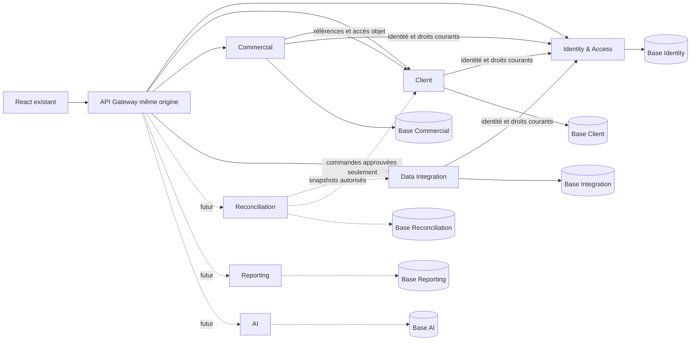

# Architecture cible par services

> Nouvelle decision utilisateur apres M2 : cible a quatre services larges sur une instance/base PostgreSQL, schemas et credentials separes. Prospects et interactions appartiennent a Client & CRM. Le [plan de decomposition courant](coarse-services-plan.md) remplace les anciennes recommandations de ce document ; les preuves historiques M1/M2 restent conservees.

**Proposition, non implémentée.** La demande utilisateur remplace la cible monolithique antérieure. [État constaté](current-architecture.md), [frontières](service-boundaries.md), [propriété des données](database-ownership.md), [étapes](migration-plan.md), [risques](risks.md).

## Choix de technologie

Conserver Django/DRF/PostgreSQL pour les extractions existantes. Les serializers, validations, services transactionnels, contraintes PostgreSQL, sessions et tests sont déjà implémentés avec ces outils. FastAPI nécessiterait de remplacer ORM/migrations, authentification, permissions et contrats sans supprimer les vrais couplages de données. Aucun besoin constaté ne justifie cette réécriture. Un service futur pourra choisir autrement sur besoin démontré, pas pour créer artificiellement une frontière.

Une image/révision, configuration, URLConf, commande de migration, base et credential d'exécution, santé/readiness et tests par service. Un même dépôt et des bibliothèques techniques versionnées sont possibles ; **pas d'import ORM inter-services**, pas d'accès SQL à la base voisine, pas de package métier commun évoluant obligatoirement en bloc. Les déploiements doivent tolérer la version précédente du contrat voisin. Pour le MVP, un PostgreSQL peut héberger plusieurs bases logiques avec propriétaires/roles distincts ; cette économie d'infrastructure ne permet ni jointure cross-database, ni credential partagé. Des clusters dédiés ne sont pas exigés d'emblée.

## Vue cible

Chaque service futur applique aussi IAM et les contrôles objet de ses sources, même si toutes les flèches de sécurité ne sont pas dessinées. Les flèches applicatives sont des API authentifiées ; les événements durables alimentent uniquement des projections autorisées. Aucun service n'écrit dans une autre base.

## Plus petite cible viable

**Checkpoint complet du MVP existant : Gateway + quatre services métier indépendants : Identity & Access, Client, Commercial et Data Integration**, chacun avec sa base. Cela préserve toutes les fonctionnalités existantes sans créer de services vides. Reconciliation est le prochain service à créer quand son workflow est spécifié ; Reporting et AI arrivent avec leurs fonctionnalités. Les sept frontières sont définies maintenant ; ne pas prétendre que les sept services fonctionnent déjà.

Étape transitoire utile : Gateway + backend historique + Data Integration extrait. C'est une transition vers la cible, **pas son achèvement** : IAM/Client/Commercial restent alors couplés dans le backend historique. Un simple découpage en conteneurs partageant tables, sessions ou migrations n'atteint pas ce checkpoint.

## Gateway et contrat navigateur

Proxy léger, par exemple Nginx dans Compose, sans base métier ni règles d'autorisation à lui seul. Il termine TLS, route les chemins existants, borne les corps/délais et uniformise les erreurs d'indisponibilité. Les routes d'activités sous `/api/clients/{id}/…` doivent être sélectionnées avant la règle générique Client. Aucun renommage des routes React ni changement de design.

Identity conserve cookie/session et endpoints CSRF ; le navigateur reste same-origin, sans jeton durable JS. Gateway conserve les codes/enveloppes/headers, les téléchargements, la taille XLSX autorisée, les UUID, et ne réessaie pas automatiquement les POST/PATCH. L'upload actuel est `application/octet-stream`, pas multipart. Ne pas appliquer la limite JSON de 64 Kio à l'upload de 10 Mio.

Les headers d'identité/capacités/corrélation fournis par Internet sont supprimés ou validés/recréés à l'entrée. Seul le proxy connu peut définir la provenance réseau/TLS. Le budget de connexion ne doit ni faire confiance à un X-Forwarded-For arbitraire ni mettre tous les utilisateurs dans un unique bucket « IP du Gateway ». Vérifier Origin/Host, Secure cookies et forwarding TLS avant routage réel ; les settings actuels ne constituent pas déjà cette configuration.

`/api/schema/` reste authentifié et expose le contrat public composé et validé hors requête ; les schémas privés ne deviennent pas publics. `/api/health/` garde son rôle de liveness minimal, sans prétendre que toutes les bases/services sont disponibles. Readiness et santé internes sont distinctes et non porteuses de données métier.

## Authentification et autorisation inter-services

Contrat interne **à concevoir et tester avant extraction** : introspection de session/droits via IAM, contexte de principal vérifiable et limité à un service, contrôles de portée métier dans chaque service. IAM est seul propriétaire du password, des sessions, memberships et définitions de rôles. Les services n'installent pas une copie inscriptible de User/RoleAssignment pour faire fonctionner SessionAuthentication.

Sur toute requête : vérifier identité active, session et grants courants ; interpréter scope/organisation/membership à l'identique ; appliquer les droits objet/finance/prospect avant données, compte et pagination. Un contexte signé doit contrôler émetteur, audience, échéance, intégrité et liaison à la requête/opération ; il n'autorise pas à ignorer une révocation ultérieure. Authentification de service et délégation utilisateur sont distinctes : un credential d'orchestrateur n'accorde pas les permissions de l'utilisateur.

CSRF des requêtes navigateur reste imposé avec les cookies de session, y compris login et upload ; l'introspection interne transporte uniquement une preuve de validation liée à la requête sur un canal authentifié. Tester aussi accès direct au service et faux headers : ni réseau interne ni Gateway ne remplacent le refus par défaut du service. IAM indisponible ou contexte douteux : échec fermé, 503 compatible ; jamais réutilisation de droits périmés pour « rester disponible ».

**Obstacle critique : la révocation concurrente.** Relire IAM avant une écriture n'équivaut pas au verrou Organization partagé actuel. Avant bascule, établir un protocole d'admission/fencing par organisation : opérations mutantes suivies jusqu'au commit/rollback ; révocation ferme l'admission de nouveaux permis, laisse finir ou annule les opérations admises, puis publie la nouvelle révision et acquitte la révocation. Réévaluer les opérations en attente de verrou local ; ne jamais considérer un permis expiré comme preuve qu'une transaction distante est terminée. Crash/timeout implique résolution durable de l'opération ou maintien du blocage, pas acquittement optimiste. Les lectures suivantes doivent voir le nouvel état immédiatement ; les mêmes barrières s'appliquent à l'organisation et au membership désactivés. L'affectation/classification Client possède sa propre révision et doit protéger les accès Commercial.

Ce protocole représente un coût réel, pas une fonctionnalité existante ni une garantie démontrée par ce document. Réutiliser le test de révocation en attente et ajouter crash/partition/commit tardif. **Sans preuve d'équivalence, conserver le chemin historique pour les écritures concernées et différer la bascule**, plutôt qu'accepter silencieusement une fenêtre de privilèges JWT/cache. Une éventuelle garantie plus faible exige une décision sécurité explicite, non fournie ici.

## Données, audit et échanges

Transactions locales uniquement. Garder les validations, versions optimistes et contraintes locales ; remplacer les relations distantes par UUID et validation propriétaire, références minimales non autoritaires et désactivation/tombstones. Aucun effacement par absence d'export.

Chaque service écrit **son journal append-only local dans la transaction métier**, avec event_id UUID, actor/org UUID, cible, résultat et corrélation. Un outbox local est écrit dans la même transaction pour livraison HTTP rejouable ; worker simple, index de livraison, retries bornés et boîte de réception idempotente. Pas besoin de Kafka ni d'un broker. Si le journal local échoue, la mutation échoue. Si la livraison centrale échoue, le journal reste durable ; alerte et replay, sans perte ni double événement.

Le module de lecture d'audit central reste sous Identity & Access pour le MVP, avec l'API `/api/audit/` et les anciennes restrictions ; ce n'est pas un huitième service obligatoire. Il conserve les événements historiques intacts et reçoit des copies minimales des nouveaux journaux. Pas de notes, cellules Excel ou secrets dans les événements. L'historique d'import est lu dans Integration localement, sans dépendre du retard de consolidation. La consolidation centrale devient potentiellement différée : documenter/borner/monitorer ce retard et faire valider ce changement avant bascule ; si la visibilité globale immédiate est exigée, ajouter une lecture fédérée autorisée ou reporter la bascule. Aucun HTTP synchrone « métier puis audit » présenté comme transaction atomique.

## Carthago et évolutions futures

Excel et synchronisation automatique future appartiennent à Data Integration : acquisition **read-only** → validation versionnée → staging → revue → snapshots immuables. Ajouter plus tard un véritable adaptateur autorisé et ses checkpoints de lecture ; authentification technique, format, cadence et reprise ne sont pas connus et ne sont pas inventés. Les retries n'écrivent jamais vers Carthago. Définir une clé d'idempotence/canal/version pour l'automatique sans fusionner aveuglément deux sources supposées identiques.

Reconciliation consomme les snapshots par API et conserve décisions/propositions ; il ne possède ni les comptes Client ni les tables Integration. Aucun appel d'application de mapping n'est activé aujourd'hui. Une règle future approuvée pourra commander au propriétaire d'une projection locale de publier une version autorisée, jamais corriger Carthago. Reporting et AI obtiennent des données autorisées et des projections propres, pas un accès SQL universel aux bases métier.
